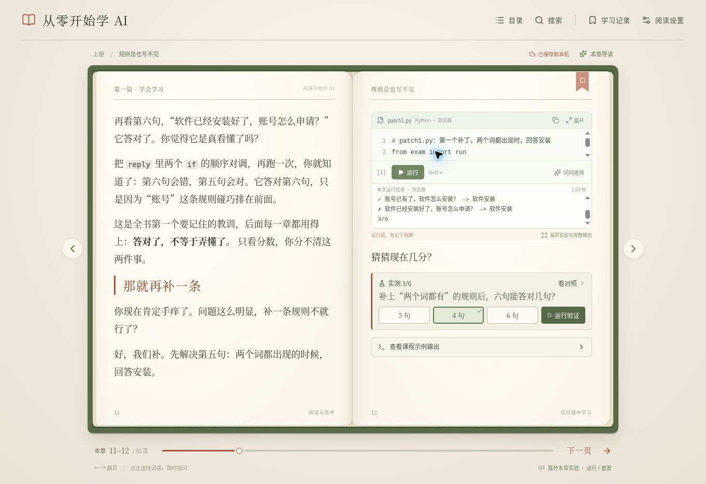

# 为什么把这门课做成一本能运行的书

这份记录供接手课程、阅读器和运行服务的人使用。它整理已经形成的项目决定、当时要解决的问题，以及后来可以怎样验证。产品目标见 [PRD](PRD.md)，重建课程数据的操作见 [维护指南](MAINTENANCE.md)。

## 读者先遇到问题，然后动手验证

上册让读者回到某种方法仍显得合理的时刻。比如，新同事问账号或软件安装，几条关键词规则看起来就够了。等同一句话里同时出现“账号”和“安装”，读者才有理由怀疑自己的办法。下册把这个提问方式带进同一个资料助手。前一章产出的文件、索引和模块会成为后面实验的输入。

这个结构决定了书页上的先后顺序。先呈现读者能判断的问题，把运行按钮放到选项旁边。运行后给出差异和下一次可独立尝试的改动。预测可以跳过，原文及完整代码始终可读。新增互动时，应能指出读者究竟在猜哪种可观察的变化，以及程序会输出什么证据。

目前有六个这样的选择题。上册第 01 章连续追踪考试、第一次补丁、第二次补丁的分数；第 02 章比较不同训练轮数的错题；第 06 章让程序核对排期；第 13 章观察重复投递通知的次数。每题关联具体原文锚点、代码单元和一个可辨认的输出。数据及解析规则见 [预测定义](../lib/course-predictions.ts)，行为约束见 [预测测试](../tests/course-predictions.test.mjs)。

## 用第一章做端到端验收

在“规则总也写不完”中找到第一次补丁，选“4 句”，运行原版 `patch1.py`。实际编译执行的 Python 对六道题逐条评分，最后输出 **3/6**。第五句改对了，第六句又分错了。“看对照”应该同时显示读者的 4 句和刚才实测的 3/6。改动代码、测试输入或输出格式后，界面须据当前运行重新判读。输出含多组分数或格式无法识别时，让读者查看原始输出。

早期排版给预测卡固定预留 238 像素，选项和操作之间留下空白，参考输出还会提前展示得分。现在按实际内容测高，六道题紧随其后的课程示例收在一个可打开的入口。其他文章里的代码、配置和流程图保留原有阅读顺序。桌面验收时这道卡片宽约 426 像素、高约 111 像素；这组数字描述一个窗口下的结果，字号、行数和窄屏换行会改变实际高度。验收还要检查运行后结果可读，关闭对照后能继续留在原页。[上线验收截图](acceptance/ai-book-compact-prediction.jpg) · [参考输出回归测试](../tests/sample-output.test.mjs)

## 界面和状态各自承担什么

| 决定 | 为什么这样做 | 维护时检查 |
| --- | --- | --- |
| 桌面双页，窄屏单页，按章节和内容锚点记录位置 | 书页过宽会显得扁平。字号和窗口变化也会让同一段文字移到不同页 | 放大字号、打开导读、收起宽屏实验区后，还能找到原段落。跨页表格、标题和实验卡用真实排版高度分页。见 [分页](../components/book-pagination.ts) 和 [阅读位置测试](../tests/book-location.test.mjs) |
| 同章单元共用运行会话，短代码直接运行，长代码可展开 | 后一段要使用前面定义的变量。把读者带到外部编辑器会打断阅读 | 运行代码后检查文字、表格、图片或报错。停止或重置后检查变量生命周期。重新打开时显示保存的修改和历史输出，通过按顺序重跑恢复变量。见 [运行时](../lib/notebook-runtime.ts) 和 [Notebook 验收](notebook-acceptance.md) |
| 学习记录直达具体实验，导出带项目依赖 | 只显示运行次数无法帮助读者接着调试。单独下载一个代码片段也可能缺少前章模块 | 从别章点回一次报错，确认定位到对应单元或文件。用干净目录试运行导出的项目。见 [学习记录测试](../tests/experiment-records.test.mjs) 和 [导出测试](../tests/experiment-export.test.mjs) |
| 术语先给课程释义，后续问题可交给带有章节上下文的 AI | 读者需要马上理解眼前这句话，也需要追问和回到引用位置 | 桌面固定导读时给书页留出宽度，手机可折叠。区分课程释义、模型回答和调用失败。回答支持逐段显示、停止和回看引用；线上模型问答要求登录。见 [导读界面](../components/ai-guide.tsx) 和 [服务端测试](../tests/guide-worker.test.mjs) |
| 视频点击后加载，中文文字稿可按句跳转，插图可以放大 | 大媒体会拖慢翻页，图表缩在书页里也难以辨认 | 切页前先检查封面和正文可读。点一句文字稿后在书中从对应时间播放。十个视频入口中九段完整，上册 05-2 仅恢复原片前 108.949 秒，界面保留片段标记和末段补读。见 [内容核对](content-audit.md) 与 [恢复片段记录](../scripts/video-excerpt.json) |

## 接手人需要保留的边界

- `course-source/` 保存课程原稿和制作素材。网页使用生成的章节与媒体，导读还使用服务端课程上下文。修改原稿后，把受影响的生成数据、图注、字幕或实验依赖一起校验并提交。
- 165 个完整 Python 单元中，34 个已经用真实浏览器 Python 验证。另 131 个涉及远端 API 或 Linux 环境。继续接入独立运行服务时，需要实际验证会话隔离、停止、配额及失败提示。详情见 [实现与验收记录](IMPLEMENTATION.md) 和 [沙箱部署说明](sandbox-deployment.md)。
- 公开仓库记录产品决策、课件、程序、数据结构及回归证据。读者的学习记录和书内 AI 对话属于读者和部署环境。开发者的账号记忆、原始私聊、生产数据库及部署凭据独立管理。
- 后续改变交互、运行时或课程编排时，请在同一变更中留下触发问题、具体决定、受影响文件、验收结果和仍未验证的条件。新成员和新的开发会话都能据此接着工作。

