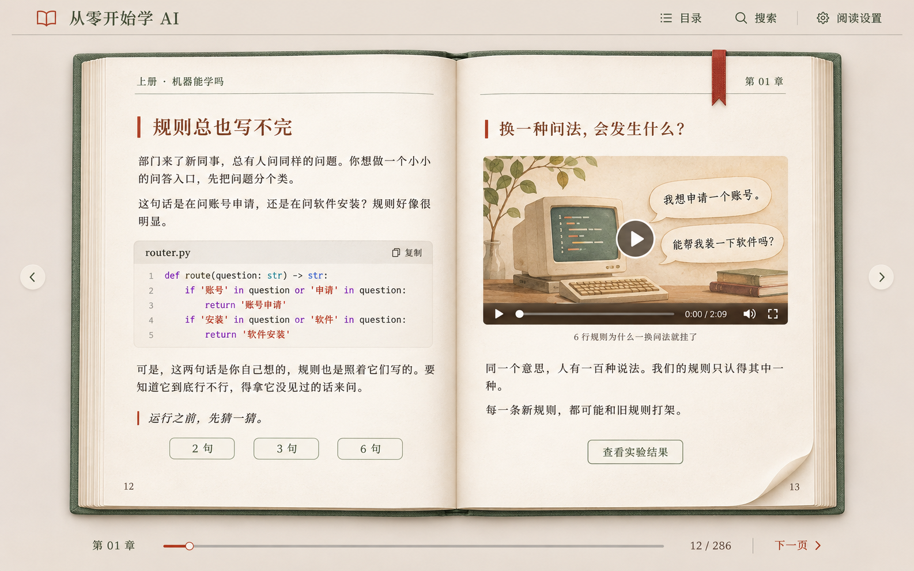
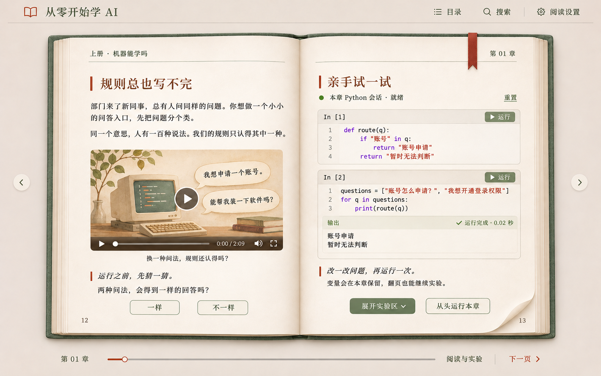

# 零基础学 AI · 交互网页书产品需求文档（PRD）

**产品名称**：从零开始学 AI：从会回答，到能做事  
**编写日期**：2026-11-18  
**文档用途**：定义完整产品目标、功能行为与交付验收标准，作为设计和开发的统一依据。  
**范围约定**：本文描述最终要交付的完整产品。开发任务可以按依赖顺序执行，完成标准始终按本文判断，不以样章、效果图或模拟交互替代交付。

## 1. 产品目标

把现有《零基础学 AI》上下册做成一本可以在浏览器里阅读、翻页、看视频、运行代码、随时向 AI 提问的交互书。

读者从封面进入书中，在叙事引导下先做判断，再亲手运行实验、观察结果，最后理解原理。阅读、视频、实验和 AI 解答在同一个学习空间内衔接，尽量不打断思考。

产品面向 AI 初学者，兼顾不同编程熟练程度。课程自身以具备基础编程理解的读者为主要对象；网站通过预置环境、分步代码、术语导读降低操作门槛，不擅自改写课程的受众定位。

### 必须达到的体验

1. **像一本认真排版的书**：字体、比例、留白和翻页自然，能长时间阅读。
2. **像一本能动手的 Notebook**：代码可编辑并真正执行，能看到真实输出、错误、图表与文件。
3. **像有一位读过本书的助教在旁边**：点关键词、选中段落或针对代码提问，得到与当前章节相关的解释。
4. **可以持续学习**：阅读位置、书签、代码修改、实验记录和导读对话能保存和恢复。
5. **内容完整且诚实**：全套课程有一致的目录、资源和实验入口，明确区分课程示例、历史输出与本次执行结果。

## 2. 内容范围与编辑原则

### 2.1 纳入的内容

| 内容 | 产品要求 |
|---|---|
| 上册正文 | 覆盖第 00–14 章、拆分章节、番外、导论、尾声、术语对照等实际文档 |
| 下册正文 | 覆盖当前下册第 01–12 章、下册导读和配套代码说明 |
| 图片与视频 | 保留原文的对应关系和适当插入位置，支持放大图片和书页内播放 |
| 课程代码与数据 | 形成可执行实验与配套文件，保留原始材料下载入口 |
| 上下册关联 | 提供“相关理论”“对应实践”的章节跳转，并可返回原位置 |
| 其他随附材料 | 按用途整理为读者资源或维护资料；不把制作记录、内部凭据等当作正文发布 |

当前已清点到上册目录下 25 个 Markdown 文档、下册目录下 14 个 Markdown 文档；这些包含导读、附录等，**不是 39 个正式章节**。压缩包内部课件需进一步建立文件清单，不能仅按直接可见脚本数量推断全部实验数量。

现有总目录仍保留旧的下册 15 章链接，而下册文件夹正文采用新的 12 章结构。**以当前“上册 / 下册”正文及配套课件为内容基准**，重新生成统一目录，旧目录保留为编辑参考，不向读者呈现两套冲突章节。

### 2.2 内容忠实性

- 保留原文“站回当年的岔路口—自己选择—实验—解释”的教学顺序。
- 不把长篇课程压缩成摘要卡片，不为迁就固定纸面高度删减正文。
- 网页适配需要改变代码文件组织时，保留教学目标和逻辑，记录与原课件的差异。
- 每个实验建立“章节、源文件、依赖、数据、运行环境、预期现象、验收结果”的映射。
- 代码输出示例明确标为“课程示例输出”；读者执行后显示“本次运行结果”。
- 随附材料中的账号、密钥、内部路径等在发布前移除或改为配置占位符。
- 代码块区分“可执行实验”“命令说明”“伪代码”和“示例输出”；说明性片段不强行运行，课程必做实验不因分类而被遗漏。
- 当前有 1 个视频文件无法读取完整媒体元数据，必须补齐或重新导出后验收；其余视频也要经过实际播放检查，不能以元数据可读代替播放验收。

## 3. 产品结构

| 页面 / 区域 | 职责 | 主要入口 |
|---|---|---|
| 封面与课程介绍 | 介绍学习主线、上下册关系，开始或继续阅读 | 打开网站 |
| 网页书阅读器 | 正文、图片、代码、视频与阅读操作 | 开始阅读、继续阅读、目录 |
| 目录与全文搜索 | 按册、篇、章定位，搜索正文与术语 | 阅读器工具栏 |
| 实验工作区 | 展开代码、文件、输出与执行控制 | 书页代码单元的“展开实验” |
| AI 导读面板 | 当前词语、段落、章节、代码的解释与追问 | 下划线术语、选中文字、实验求助 |
| 我的学习记录 | 阅读位置、书签、已保存实验和导读记录 | 阅读器工具栏 |

封面以“开始阅读 / 继续阅读”为核心操作。进入阅读器后，把正文作为视觉中心，目录和助教按需展开，避免常驻多栏挤压书页。

## 4. 阅读器与视觉要求

### 4.1 视觉基调

沿用已认可的概念方向：暖白纸面、低饱和绿色书封、少量赭红强调色、轻微书脊和纸张层次。封面与章节标题采用协调的中文宋体 / 明体风格，界面控件用易读字体，代码用等宽字体。

所有标题和正文使用真实网页文字排版，能够选中、搜索和适配屏幕；封面插图与文字分开制作，不把生成图片里的文字作为最终标题。

默认正文建议 18–20 px、行高约 1.7–1.9，最终按屏幕与字体实测调整。书本效果不能以缩小文字、过度倾斜页面或遮挡内容为代价。

### 4.2 翻页与排版

- 宽屏呈现双页，窄屏自动单页；手机不要求横屏，也不依靠缩小整本书适配。
- 提供上一页、下一页、目录跳转与键盘左右键；可关闭翻页动画，尊重系统减少动态效果设置。
- 文字输入、代码选中、视频拖动、点击术语时，不触发翻页。
- 翻页动画有轻微纸张运动与阴影，正文保持清晰；不默认播放翻页音效。
- 分页依据内容块与实际屏幕尺寸计算。代码单元、表格、图片尽量不被截断。
- 超长代码和输出可展开；大表格有独立横向滚动或放大查看，整个页面不能被撑破。
- 改变字号、窗口宽度、屏幕方向后，仍定位到同一段内容。
- 阅读进度保存“章节 ID + 内容锚点”，页码作为当前排版下的显示信息。
- 搜索和章节跳转后，提供返回原阅读位置的操作。
- 顶部显示当前章节，底部显示当前位置和阅读进度；不虚构总页数。

### 4.3 阅读工具

目录可按上下册与篇章展开，标记当前位置。全文搜索覆盖实际课程内容，结果展示片段，点击定位并高亮。支持书签、字号调整和动画设置；这些设置能保存。

### 4.4 设计参考与原型图集

本节汇总本次讨论中已有的草图、封面和界面设计，和功能条款一起作为开发依据。**图 03 是阅读与实验并置时的主要界面参考；图 02 用于正文与视频的排版参考。** 图片中的页码、总页数、代码、输出与耗时属于构图示例，实际产品使用真实课程内容和运行状态。

| 图号 | 设计内容 | 主要对应要求 |
|---|---|---|
| 图 00 | 用户原始布局草图 | 双页书本、书页内视频、页角翻页 |
| 图 01 | 调整字体与比例后的封面 | 封面气质、中文标题层级、插图与配色 |
| 图 02 | 双页阅读与视频界面 | 阅读器工具栏、正文、视频、预测与翻页导航 |
| 图 03 | 书页内 Notebook 实验界面 | 编辑代码、逐单元运行、真实输出、会话与展开实验 |

#### 图 00 · 原始布局草图

**设计意图**：网页中心是一册展开的书，左右页放置正文，视频嵌在正文之间，读者可以从页角继续翻阅。这张草图定义布局关系，具体字体、颜色和比例采用下面的界面设计。

#### 图 01 · 书籍封面

**设计意图**：暖纸色与绿色山丘构成背景，一条红线贯穿学习路径，从早期机器意象走向书本和实际工作的书桌，呼应“从会回答，到能做事”。

**落地要求**：沿用经过调整的中文标题层级与留白；正式网页中的标题、副标题和入口用真实文字与控件绘制。插图和文字拆分使用，不能将整张封面图当作唯一的交互入口。

#### 图 02 · 双页阅读与视频

**设计意图**：绿色书封和轻微纸张厚度围合阅读区；顶部提供目录、搜索与阅读设置，底部提供章节进度和翻页。正文、代码片段、预测问题与视频共同构成阅读内容。

**落地要求**：视频可实际播放，文本可选择和搜索，预测可记录。图中代码仅呈现复制入口；产品中的可执行单元必须采用图 03 的运行方式。左右页承载的内容随章节变化，不把“左页文字、右页视频”写死成每一页的模板。

#### 图 03 · 书页内 Notebook 实验

**设计意图**：左页承接叙事、视频和“先猜一猜”，右页提供本章 Python 会话、可编辑的多个代码单元、运行按钮和紧随单元的输出，让读者在阅读中自然进入实验。

**落地要求**：

- “运行”执行当前编辑后的代码，输出随代码变化；图上的完成标记和耗时由实际执行结果生成。
- 同章单元共享状态，翻页后可继续使用前面的变量；“重置”明确作用于当前实验环境。
- “展开实验区”切换到适合长代码、多文件和长输出的工作区，关闭后回到同一阅读位置。
- “从头运行本章”按正确顺序执行，并显示执行进度；有外部副作用的操作遵循第 6 节规定。
- 代码和正文的字形、边距与色彩协调，保持可读性；纸张装饰不能挤占编辑空间。

#### 设计图与完整功能的对应

现有图集展示封面、桌面阅读、视频和 Notebook 的视觉方向。AI 导读弹窗、手机单页、展开实验区，以及加载、错误和保存状态尚未出现在这些静态图片里，仍属于本文明确要求的完整产品功能。

AI 导读沿用同一套纸色、绿色和中文字体体系：术语用细虚线下划线，点击后在邻近位置展开解释与追问；手机使用底部面板。具体行为按第 7 节实现，不能因为图中未画出而遗漏。

实现与验收时，**视觉以本节图集为参考，真实行为与完整范围以第 5–10 节为准**。图集是设计参考，不表示网页、代码执行或 AI 服务已经实现。

## 5. 书页内视频

- 视频在原文对应位置展示封面、标题和播放按钮，读者点击后播放。
- 支持暂停、进度拖动、音量、倍速与全屏；视频错误时提供重试及明确提示。
- 离开当前书页时暂停，回来恢复到原时间；同一时刻只播放一个课程视频。
- 按需加载当前及邻近内容，不能打开一本书就下载全部视频。
- 图片可放大，关闭后返回原阅读位置。
- 视频和大资源由对象存储 / CDN 直接提供，避免全部穿过 10 Mbps 应用服务器出口。
- 实际播放、拖动、全屏和恢复进度都要验证；静态封面和虚假播放控件不计完成。
- 有字幕的素材展示字幕；没有字幕时提供对应讲解文字的入口，不能把不可访问的视频作为唯一知识来源。

## 6. 可执行实验与 Notebook

### 6.1 代码单元

每个可运行单元必须包含编辑区、运行按钮、执行状态、输出区；支持复制、停止和恢复课程原始代码。多文件实验提供文件列表，能查看、修改并运行正确的入口。

显示状态包括：环境未准备、加载中、就绪、排队、运行中、完成、错误、中断、超时。失败不能只显示一个永久转圈图标。

输出支持标准输出、错误堆栈、表格、图像以及可下载的生成文件。超过输出上限时提示截断，避免日志撑满页面或拖垮浏览器。

### 6.2 会话与依赖

- 同一章、同一实验项目的单元共享 Python 状态和文件空间；翻页与展开工作区不重建环境。
- 每个单元显示执行序号。修改代码后，旧输出标记为“修改前的结果”。
- 提供“运行当前单元”“运行前置单元”“从头运行本章 / 项目”“重置环境”。
- 对未执行前置步骤导致的错误，显示原始错误并提供可理解的操作提示。
- 跨章项目需要延续文件时，通过明确的项目工作区承接；不能无提示地复制整份变量状态。
- 刷新页面后恢复代码与历史输出，但不把历史输出当作内核仍存活的证明。
- 远端会话过期或本地运行时销毁时，清楚说明需要重新执行；重新执行可能产生 API 用量，不自动重跑有外部副作用的单元。
- 重置只影响当前读者的当前实验；覆盖未保存代码前明确提示。

### 6.3 运行环境

| 实验需求 | 指定执行方式 | 完成条件 |
|---|---|---|
| 纯 Python、小规模数学和算法实验 | 浏览器 Python 运行时 | 真正执行修改后的代码，支持同章状态与实际输出 |
| 外部模型调用 | 经过服务端受限代理调用模型 | 返回真实响应、错误与可获得的用量信息，不向实验暴露主密钥 |
| Linux 进程、文件锁、MCP 服务、多文件工程等 | 独立云端 Python / Linux 沙箱 | 支持课件所需系统能力，读者会话相互隔离 |
| 依赖 GPU 或较多算力的训练 | 匹配资源的独立执行任务 | 实际运行、展示日志与结果；排队、限额、取消状态明确 |

每个实验在开发前完成环境分类和依赖检查。**课程承诺可以运行的实验必须接通实际执行环境**。如果某项资源尚未提供，该实验属于未完成项；不通过播放录像、固定返回值或预先生成输出替代。

课程中原本用于说明机制的 mock 可以保留，但必须沿用明确的教学标识，不把 mock 包装成真实模型或工具执行。

### 6.4 教学交互

“运行前先猜”嵌入相关实验，可记录自己的预测，也可直接运行。执行后对照预测与真实结果，再进入解释。保留课程的发现过程，不强制答题解锁章节。

提供“解释这段代码”“帮我理解这个报错”。附上哪些代码和错误由读者可见，AI 的修改建议需读者主动应用，不能悄悄改写实验。

### 6.5 隔离与资源控制

浏览器代码在独立执行上下文运行，与账号凭据隔离。云端代码不能直接在网站主进程执行，必须具备用户隔离、文件隔离、网络策略、超时、资源和输出限制。

网站、数据库、其他读者文件及平台长期密钥不能进入实验文件系统。用户只能上传、下载自己的实验文件；文件类型、大小和保存配额可配置，并向用户展示超限原因。

下载支持单个代码文件、实验项目包，以及能够合理表达为 Notebook 的实验导出。导出文件不含平台凭据。

## 7. AI 导读

### 7.1 入口与呈现

- 经过编辑标注的关键词使用细虚线下划线，与普通网页链接区分。
- 同一页不反复强调同一个术语，避免满页下划线。
- 点击术语，在附近打开弹窗；手机使用底部面板。可关闭、固定到侧边或继续追问。
- 弹窗立即显示已有课程释义，并自动请求结合当前上下文的 AI 解释。两个部分分别标注“课程释义”和“AI 解答”。
- 选中一段文字后提供“请 AI 解释”；阅读器提供“本章导读”入口。
- 代码区域提供解释代码与报错求助入口，复用同一助教能力。
- 弹窗支持键盘打开、关闭和焦点返回；不遮住正在操作的代码或让读者失去原阅读位置。

### 7.2 回答要求

AI 请求包含当前册、章节、段落、术语、必要的相关课程片段和有限的追问历史。实验求助另带读者选择的代码与输出。

优先用本书已经出现的概念解释，避免一上来引入大量后续术语；必要时提示相关章节。来源链接必须指向实际存在的课程段落。

提供“说得更简单”“举个例子”“结合当前代码解释”等追问。AI 不确定时明确表达，不虚构课程原文、实验运行结果或自己没有执行过的操作。

尽量采用流式显示；模型协议不支持流式时使用完整回答模式。关闭或切换问题后，可以取消当前请求，旧响应不能覆盖新问题。

### 7.3 异常与费用

AI 超时、限流、余额或模型不可用时，保留课程释义和阅读能力，显示真实错误类别和重试入口。不能用固定释义冒充已成功调用 AI。

服务端保管商汤凭据，按用户限制请求频率、并发、输入输出长度和用量。缓存只复用适用的相同课程解释；含个人代码或对话的记录按用户隔离。

模型 ID 和接口地址可配置。接入完成需要验证真实请求、追问、错误处理与实际账号权限，不能仅凭公开文档认定已接通。

## 8. 学习记录与数据

| 数据 | 保存与恢复规则 |
|---|---|
| 阅读位置、字体设置、书签 | 自动保存；登录后可跨设备恢复 |
| 代码修改与实验文件 | 自动保存，展示“保存中 / 已保存 / 保存失败” |
| 实验输出 | 保留与代码版本、执行时间、执行环境的关联，清楚标记历史记录 |
| AI 导读对话 | 关联章节与上下文，读者可继续或删除 |
| 运行内存状态 | 当前会话有效；不承诺刷新、设备切换或环境回收后自动恢复 |

自建站无需注册或登录。首次打开书时，站点为这个浏览器签发随机访客凭证。读者在同一浏览器可以接续进度、代码和导读，同一网络里的其他读者有独立记录。实验环境按读者与章节隔离。换设备时，可用“学习记录”里的导出和导入接续，也可登录同一个本站账号继续该账号的记录。原托管站沿用平台身份。[自建站身份与验收](CONTAINERS.md)

本地缓存用于断网或保存失败时的恢复辅助，不取代服务器持久保存。跨设备同时修改时，不能静默覆盖较新的代码；保留冲突副本或提示选择。

课程原始代码与读者修改分开保存。更新课程内容时保留稳定章节和单元 ID，不能因重新分页清空进度或覆盖读者实验。

读者可以导出自己的学习数据并删除个人记录。删除、备份保留及恢复规则需在部署说明中明确，不能让删除操作误伤课程原始资料或其他用户。

## 9. 内容维护与部署

课程继续以 Markdown、代码、数据和媒体文件为主要来源。建立内容转换与检查流程，维护章节清单、术语、图片视频路径、实验入口与运行环境。更新内容不要求手工修改每一张网页。

交付完整源码、依赖锁定文件、部署配置、凭据配置项说明、数据库初始化 / 迁移、备份恢复和内容更新说明。凭据只通过运行环境注入，不进入源码或下载包。

### 部署分工

- **应用服务**：阅读器、登录、学习记录、课程检索与 AI 代理。
- **媒体服务**：视频、图片和运行时资源。
- **实验服务**：独立 Linux / GPU 沙箱，与应用服务解耦。
- **模型服务**：使用外部商汤 API，避免在应用机部署大模型。

已有 2 核 / 4 GiB、80 GB SSD、10 Mbps Ubuntu 主机可作为应用服务的候选部署位置。是否能与已有服务共用必须依据实际占用和负载测试判断；不把标称配置当作可用余量，也不把完整实验集群的成本计入这台机器。

在当前云端工作区完成开发、构建和可用网页验证。正式目标服务器接入失败不能冒称部署成功；网站托管环境也不能冒称已具备任意 Linux / GPU 执行能力。

## 10. 验收标准

以下均属于完整交付要求，不以截图或按钮外观替代实际验证。

| 编号 | 验收项目 | 通过条件 |
|---|---|---|
| A01 | 内容完整 | 课程清单内全部读者文档可访问，目录唯一一致，无未标明的漏章 |
| A02 | 资源有效 | 图片可查看、视频可实际播放，内部跳转与下载有效，损坏资源已解决 |
| A03 | 书本体验 | 桌面双页、手机单页，字体清晰；改字号和旋转屏幕后仍回到原内容 |
| A04 | 交互不冲突 | 选代码、输入、拖视频、点术语时不误翻页，动画可关闭 |
| A05 | 代码真实执行 | 修改输入或逻辑，输出随代码变化；语法错误显示真实报错 |
| A06 | 同章共享状态 | 前一单元定义变量 / 函数，翻页后后一单元可使用；重置后状态确实清空 |
| A07 | 复杂实验 | 多文件导入、系统进程、文件锁等按课程要求在真实环境中通过 |
| A08 | 训练任务 | 需要独立算力的可运行训练任务有真实日志、结果和取消机制，无假输出 |
| A09 | 中断与故障 | 无限循环或超时可终止；单个实验失败不阻断阅读或损坏其他用户数据 |
| A10 | AI 导读 | 点击术语得到结合段落的真实模型回答，追问连续，课程来源可跳转 |
| A11 | AI 异常 | 限流、超时、额度不足有明确提示，课程释义与阅读仍可用 |
| A12 | 数据恢复 | 重新打开和跨设备登录能恢复进度及代码；历史结果与存活会话区分清楚 |
| A13 | 多用户隔离 | 两个未登录的浏览器在同一网络中各自保存进度、代码和对话，重置其一的实验不会影响另一位；两份本站账号也满足相同隔离要求 |
| A14 | 凭据保护 | 前端资源、下载文件和实验环境中均无平台长期密钥 |
| A15 | 内容更新 | 更新章节后，目录与检索同步更新，已有书签和用户代码不被无故清空 |
| A16 | 部署交付 | 可访问的实际网站、匹配源码与部署文档齐全，检查结果和未解决问题如实记录 |

### 性能与兼容性验收

以桌面 Chrome / Edge / Safari 和移动端 Safari / Chrome 的当前稳定版本为检查对象。测试普通阅读、长代码、长输出、视频与 AI 面板同时出现的场景。

在约定的测试网络与设备上，翻页操作的界面反馈目标为 200 ms 以内；正文就绪后，未加载的实验运行时和视频不能阻塞阅读。运行环境首次加载、AI 首字时间与网络请求分别记录，不伪造统一的即时完成时间。

业务容量按明确的阅读、保存、AI 调用和实验负载组合压测，记录 p95 延迟、错误率、CPU、内存和带宽。在线人数、AI 同时请求数与沙箱并发数分开给出；不在无测试依据时承诺“支持多少人”。

## 11. 当前明确依赖与处理原则

| 依赖 / 现状 | 处理要求 | 对完成判定的影响 |
|---|---|---|
| 内容目录存在新旧差异 | 按当前正文生成统一目录，建立来源映射 | 未处理不能通过内容验收 |
| 1 个视频文件无法正常解析 | 找到完整源文件或重新导出，并实际播放 | 未解决不能宣称全部媒体完成 |
| 商汤凭据已提供，但账号能力未实测 | 服务端配置后验证模型、协议、额度与错误处理 | 未验证不能宣称 AI 已接通 |
| 当前工作区没有 Docker，托管后端不是通用 Linux 沙箱 | 接入可用的独立沙箱运行服务，核验隔离和课程兼容性 | 未接入不能宣称完整实验体系完成 |
| GPU / 重计算执行资源尚未确定 | 按实验清单确定所需资源与预算并落实执行服务 | 对应可运行训练任务仍为未完成 |
| 当前环境无法 SSH 目标服务器 | 获取可达的受支持部署通路或在用户可达环境部署 | 可继续开发，但不能宣称已检查或部署该主机 |

遇到依赖未满足时，继续完成不依赖它的工作，并准确记录阻塞项。只有确实需要用户补充资源或做业务决定时才提出具体问题；不通过缩减目标或用静态演示替换功能来消除阻塞。

## 12. 本次不包含的业务扩展

不包含支付订阅、优惠券、招生 CRM、班级管理、作业批改平台、社区评论、证书体系、直播教学和原生手机 App。这些不属于当前沟通确定的网页书目标。

不额外建设复杂的在线课程编辑后台；课程维护通过现有文稿、资源与可重复的发布流程完成。

## 13. 开发交付清单

- [ ] 完整内容清单、统一目录、资源及实验映射。
- [ ] 与已认可风格一致的封面、阅读器和响应式排版。
- [ ] 全书阅读、搜索、目录、书签与视频。
- [ ] 浏览器 Python、独立云端实验和所需训练运行环境。
- [ ] 真正可编辑执行的实验、共享会话、文件与真实输出。
- [ ] 术语 / 段落 / 代码 AI 导读与追问。
- [ ] 用户隔离、跨设备学习记录和故障恢复。
- [ ] 实际可访问网站、源码、部署迁移和内容维护文档。
- [ ] 逐项验收记录与已解决的缺陷清单。

**完成定义**：用户能够打开完整课程，连续阅读与观看，修改并执行课程实验，获得与当前内容相关的 AI 帮助，并在下一次回来时继续学习。所有功能的真实性、完整性与限制均有可复核的验收结果。

